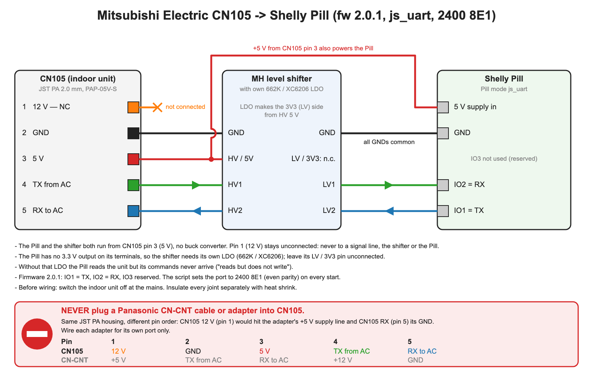
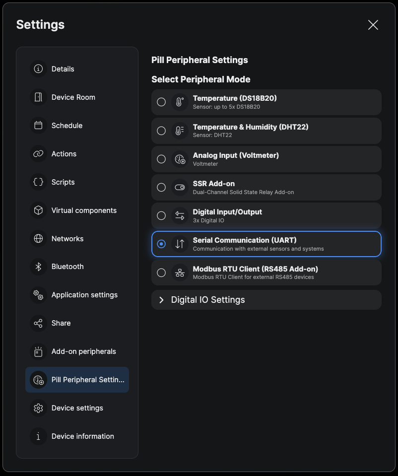
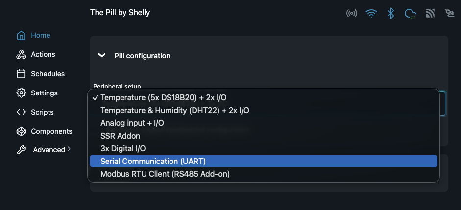

# Mitsubishi Electric heat pump control with a Shelly Pill (CN105)

Control a Mitsubishi Electric indoor unit from the Shelly app — and optionally from
Home Assistant over MQTT — using nothing but a **Shelly Pill** plugged into the unit's
**CN105** service port. No ESPHome, no extra microcontroller — one Shelly script does the
CN105 protocol and the Shelly app controls; MQTT and Home Assistant are optional add-ons.

**Requires The Pill firmware 2.0.1 or later** (the `js_uart` peripheral mode first
appeared in 2.0.1).

The protocol implementation is a port of
[echavet/MitsubishiCN105ESPHome](https://github.com/echavet/MitsubishiCN105ESPHome)
(reverse engineering by [SwiCago/HeatPump](https://github.com/SwiCago/HeatPump)).

## What is in the kit

| File | Purpose |
|---|---|
| `mitsubishi_cn105.shelly.js` | The Shelly script. Paste it into the Pill; edit the `CFG` block only for MQTT / Home Assistant. |
| `homeassistant/mitsubishi_ac.yaml` | Optional Home Assistant package: climate entity + sensors + extra controls over MQTT. |
| `../../docs/pill-peripheral-uart.png` | Screenshot for section 2: selecting the UART peripheral mode in the Shelly app. |
| `../../docs/pill-peripheral-uart-webui.png` | Screenshot for section 2: the same selection in the Pill's web UI. |
| `wiring.png` | Wiring diagram for section 1 (source: `wiring.svg`). |

What you get:

* **Shelly app**: a virtual device (group) with Power, Mode, Fan, Vane, Wide vane,
  Target temperature (slider) and Room temperature (read-only).
* **HTTP**: `GET/POST http://<pill-ip>/script/<id>/cn105` returns the state; POST a JSON
  command body to control.
* **Room sensor** (optional): a Shelly BLU H&T (or any BTHome temperature sensor) paired
  to the Pill becomes the pump's room temperature, without Home Assistant (section 4,
  *Feeding an external room temperature*).
* **MQTT** (optional): `<prefix>/state` (JSON, every ~10 s) and `<prefix>/set` (JSON commands).
* **Home Assistant** (optional, over MQTT): a `climate` entity (mode, target temperature, fan, vertical vane,
  hvac_action incl. `defrosting`), sensors (room/target/outside temperature, compressor frequency, power,
  energy, runtime, raw mode/fan/vane, sub mode, stage, room temperature source), binary sensors
  (power, operating, defrost, link status, i-See), a horizontal-vane `select` and a `number` to feed
  an external room temperature.

## 1. Hardware

CN105 is a 5-pin JST-PA connector on the indoor unit's control board:

| CN105 pin | Signal | Note |
|---|---|---|
| 1 | 12 V | Not used — leave unconnected. **Never** connect to a signal line or to the Pill. |
| 2 | GND | Common ground |
| 3 | 5 V | Powers the Pill and the level shifter's high side. |
| 4 | TX (unit → Pill) | 5 V logic |
| 5 | RX (Pill → unit) | 5 V logic |

The Pill uses **3.3 V logic**, so a bidirectional level shifter is required
(a 2-channel MH-type module with the 662K LDO works well):

```
CN105 pin3 5V  -> shifter HV        (leave the shifter's LV/3V3 pin unconnected if it has its own LDO)
CN105 pin3 5V  -> Pill 5 V supply   (same wire feeds shifter HV)
CN105 pin2 GND -> shifter GND (both sides) -> Pill GND
CN105 pin4 TX  -> shifter HV1 ... LV1 -> Pill IO2  (Pill RX)
CN105 pin5 RX  <- shifter HV2 ... LV2 <- Pill IO1  (Pill TX)
```



The Pill's UART is on **IO1 = TX** and **IO2 = RX**. In `js_uart` mode the firmware marks
all three IO pins as reserved; leave IO3 unconnected.

## 2. Prepare the Pill

1. Update the Pill to firmware **2.0.1 or later** (Web UI → Settings → Firmware, or the
   Shelly app).
2. Select the **Serial Communication (UART)** peripheral mode, either in the Shelly app or
   in the Pill's web UI. The script log shows this mode as `js_uart`.

   * **Shelly app:** open the Pill → **Settings** → **Pill Peripheral Settings** and under
     **Select Peripheral Mode** choose **Serial Communication (UART)** — *Communication with
     external sensors and systems*.

     

   * **Web UI** (`http://<pill-ip>/`): **Home** → **Pill configuration** → **Peripheral setup**
     → **Serial Communication (UART)**.

     

You do not need to set the baud rate or parity. The script puts serial port 0 into
`js_uart` 2400 8E1 on every start and fixes it without a reboot if something changed it —
a firmware update, for example, resets the port to 115200 8N1.

Note: firmware 2.0.1 reports the Serial mode as `js_uart`, while the API documentation's
example shows `jsuart`. The script accepts both spellings.

## 3. Install the script

1. Web UI → **Scripts** → **Add script**, paste the whole `mitsubishi_cn105.shelly.js`, **Save**, **Start**,
   and enable **Run on startup**. For control from the Shelly app the file needs no changes;
   the `CFG` block is edited only for MQTT / Home Assistant (section 4). Optional:
   `VC_GROUP_NAME` sets the name of the virtual device in the Shelly app.

2. Watch the script log. A start looks like this, and a state line follows every poll
   cycle (~10 s):

   ```
   [cn105] Fixing Serial config -> js_uart 2400 8E1
   [cn105] UART 2400 8E1
   [cn105] Connected to heat pump (0x7A)
   [cn105] fw=2.0.1 app=Pill
   [cn105] Pill mode="js_uart" pin0="reserved" pin1="reserved" pin2="reserved"
   [cn105] BTHome remote temp: no temperature sensor paired -> pump's own sensor, searching again every minute
   [cn105] Virtual components ready (group MitsubishiAC)
   [cn105] {"connected":true,"power":"ON","mode":"HEAT","temp":21,"fan":"AUTO",...,"room_temp":22.5,...}
   ```

   The `BTHome` line is normal without a room sensor: the pump uses its own sensor, and a
   sensor paired later is picked up within a minute.

   The exact order of the lines can vary. `Fixing Serial config` appears only when the
   serial port was not already 2400 8E1. With the default `MQTT_ENABLE: false` the script
   does not touch MQTT at all.

### Start-up order

Firmware 2.0.1 stops a script that has more than five RPC calls in flight at once
(`Too many calls in progress`). The script therefore starts in stages, one after another:
serial port and CN105 link first, then diagnostics, then the virtual components and
finally the MQTT broker settings (only with `MQTT_ENABLE: true` and `MQTT_HOST` set, section 4). If you add your
own `Shelly.call()`s, start them after the `Virtual components ready` line, not at the top
level of the script.

## 4. MQTT and Home Assistant (optional)

Home Assistant talks to the script over MQTT. Skip this section if you only use the Shelly
app. The same MQTT topics also work with other systems, such as Node-RED (section 5).

You need an MQTT broker and, for Home Assistant, the MQTT integration connected to the same
broker as the Pill.

### MQTT settings in the script

Edit the `CFG` block at the top of `mitsubishi_cn105.shelly.js` and save the script again.
`MQTT_ENABLE` is the master switch — with the default `false` nothing below is used:

```js
MQTT_ENABLE: true,           // turn MQTT on (default false = Shelly app and HTTP only)
MQTT_HOST: "192.168.1.10",   // your broker ("" = configure MQTT in the web UI instead); "host:port" also works
MQTT_PORT: 1883,
MQTT_TLS: false,             // true = TLS checked with the Pill's built-in CA bundle; port 8883 unless set
MQTT_USER: "mqtt",
MQTT_PASS: "secret",
MQTT_RPC: true,              // false = no Shelly RPC, notifications or MQTT control over MQTT
MQTT_PREFIX: "mitsuac",      // topic prefix, must match the HA package

HA_DISCOVERY: false,         // false = use the HA package (default), true = script announces the climate itself
HA_DISC_ID: "mitsuac",       // KEEP STABLE — changing it creates a new entity in HA
HA_NAME: "MitsubishiAC",
HA_DEVICE_NAME: "MitsubishiAC",
```

### How the MQTT broker settings are applied

If `MQTT_ENABLE` is `true` and `MQTT_HOST` is set, the script writes host/port/TLS/user/password into the Pill's own MQTT
component on first start and **reboots the Pill once** to activate it. The Pill's MQTT may be off before that —
the first start then logs `MQTT is off on the Pill - <prefix>/set not subscribed yet`, and after the reboot
everything is subscribed. This is the last
start-up stage, so the reboot never interrupts the creation of the virtual components. It also sets the
Shelly MQTT **prefix** to `MQTT_PREFIX`, so the device's online/offline (LWT) topic becomes
`<prefix>/online` — that is what the Home Assistant package uses for availability.

A signature of the applied values is stored in the Pill's KVS, so:

* editing the password in `CFG` and re-saving the script re-applies it (one more reboot),
* an unchanged config never reboots again,
* if the config does not stick after 3 attempts the script gives up and logs an error.

With the defaults `MQTT_TLS: false` and `MQTT_RPC: true` the script does not touch the TLS and RPC
settings of the web UI. It only undoes TLS or RPC settings it made itself (e.g. after the test broker).

If you prefer to configure MQTT by hand (`MQTT_HOST: ""`), set the **MQTT prefix** in the
web UI to the same value as `MQTT_PREFIX`; the script logs a warning if they differ.

The first start with `MQTT_HOST` set looks like this:

```
[cn105] UART 2400 8E1
[cn105] Connected to heat pump (0x7A)
[cn105] fw=2.0.1 app=Pill
[cn105] Pill mode="js_uart" pin0="reserved" pin1="reserved" pin2="reserved"
[cn105] Virtual components ready (group MitsubishiAC)
[cn105] Applying MQTT broker 192.168.1.10:1883 user=mqtt prefix=mitsuac (attempt 1)
[cn105] MQTT config applied — rebooting once to activate it
```

After that reboot, and on every later start, the MQTT lines are gone.

### Test broker / TLS

A pre-configured test Pill reports to a TLS broker with its own user (prefix `pill/<tester>/mitsubishi`).
The broker uses a Let's Encrypt certificate, which the Pill's built-in CA bundle (`ssl_ca: "ca.pem"`)
accepts, so no certificate has to be loaded:

```js
MQTT_ENABLE: true,
MQTT_HOST: "mqtt.pill.tscod.org:8883",
MQTT_TLS: true,
MQTT_USER: "<tester>",
MQTT_PASS: "<from pill-tester>",
MQTT_RPC: false,             // the broker accepts only <prefix>/set from the maintainer
MQTT_PREFIX: "pill/<tester>/mitsubishi",
DEBUG: true,                 // frame dump on <prefix>/debug for the first day
```

The start log then shows `Applying MQTT broker mqtt.pill.tscod.org:8883 TLS user=<tester>
prefix=pill/<tester>/mitsubishi rpc=false (attempt 1)` and the Pill reboots once. `MQTT_RPC: false` sets
`enable_rpc`, `rpc_ntf`, `enable_control` and `status_ntf` off, so only the script's own topics and the
`online` topic are used. `DEBUG: true` switches itself off after `DEBUG_AUTO_OFF_MIN` (default 1440 = one day);
the maintainer can switch it back on with `{"debug":true}` on `<prefix>/set` (section 5).

### Option A — package (default, recommended)

1. Copy `homeassistant/mitsubishi_ac.yaml` to `<config>/packages/`.
2. Make sure `configuration.yaml` loads packages:

   ```yaml
   homeassistant:
     packages: !include_dir_named packages
   ```

3. Restart Home Assistant. A device **MitsubishiAC** appears under the MQTT integration
   with `climate.mitsubishiac` and the sensors/controls listed above.

The package contains the climate entity, so leave `HA_DISCOVERY: false` in the script.
The package and the script's discovery use the **same** `unique_id`s, so if you switch
between the two later HA keeps the same entities instead of creating duplicates.

### Option B — MQTT discovery (no YAML)

Set `HA_DISCOVERY: true` (together with `MQTT_ENABLE: true`) in the script and do not install the package. The script publishes
a retained discovery message for the climate entity and re-publishes it every time HA
starts (it listens to HA's birth message on `homeassistant/status`), so the entity survives
broker restarts and HA restarts without any manual step. You get the climate entity only —
no extra sensors.

### Feeding an external room temperature

The pump normally regulates on the sensor inside the indoor unit, which usually hangs
near the ceiling and reads warmer than the room. You can give it a room sensor instead in
two ways.

#### Option 1 — a Shelly BLU sensor paired to the Pill (no Home Assistant needed)

1. Pair the sensor (e.g. Shelly BLU H&T) to the Pill as a BTHome device (Shelly app or the
   Pill's web UI, Bluetooth settings). The Pill creates one component per value (battery,
   humidity, temperature, …).
2. Leave `REMOTE_TEMP_BTHOME_ID: "auto"` in `CFG`. The script finds the temperature sensor
   by itself and the pump starts using it. The script log shows:

   ```
   [cn105] BTHome temperature sensor: id=203 addr=fc:4d:6a:39:57:67 value=20.2
   [cn105] BTHome remote temp: id=203, value=20.2, age=47s
   ```

3. If the Pill has more than one temperature sensor, `"auto"` will not guess. The log lists
   them all, each with its id and MAC address:

   ```
   [cn105] BTHome temperature sensor: id=203 addr=fc:4d:6a:39:57:67 value=20.2
   [cn105] BTHome temperature sensor: id=207 addr=aa:bb:cc:dd:ee:ff value=19.9
   [cn105] BTHome remote temp: several sensors -> set CFG.REMOTE_TEMP_BTHOME_ID to one of the ids above -> pump's own sensor, searching again every minute
   ```

   Set the one you want, e.g. `REMOTE_TEMP_BTHOME_ID: 203`.

   **Finding the id without the log:** web UI → Home → the sensor's card → pencil icon next
   to **Temperature**. The id is in the page header and in the address bar, e.g.
   `bthomesensor:203` / `…/#/bthomesensor/203/settings`. (The `[0]` on the card is the
   value index, not the id.) Or open `http://<pill-ip>/rpc/Shelly.GetComponents?dynamic_only=true`
   and look for the `bthomesensor` whose `obj_id` is `69` (or `2`).

How it behaves:

| Situation | What the pump uses |
|---|---|
| Sensor paired and sending | the sensor's temperature (sent at once on a change of 0.5 °C or more, otherwise with the next 20 s keepalive) |
| No sensor paired | its own sensor, and the script does not stop. With `"auto"` the script searches again every minute |
| Sensor paired later | taken into use within about a minute, with no restart needed |
| Sensor removed from the Pill | its own sensor within 20 s |
| Sensor silent (battery out, out of range) | its own sensor 30 min after the last reading (`REMOTE_TEMP_TIMEOUT_MS`) |
| Reading older than 15 min at start-up | ignored (`REMOTE_TEMP_BTHOME_MAX_AGE_S`) |
| `remote_temp` written over MQTT/HTTP | used until the next sensor reading |

`REMOTE_TEMP_BTHOME_ID: -1` switches the feature off; the pump then uses its own sensor
unless you feed a value as in option 2.

A BLU H&T sends roughly once a minute. Some packets carry only battery and firmware
information, and a few are missed over the air, so 2–4 minutes between temperature
readings is normal. The 15 min and 30 min limits allow for that.

While a room sensor is in use, the pump reports that same temperature back as `room_temp`.
The reading of its own built-in sensor is not available over CN105 at that time.
`remote_temp_source` (`bthome` / `manual` / `internal`) and `remote_temp_age_s` in
`<prefix>/state` show what the pump is using.

#### Option 2 — any Home Assistant sensor

Set `REMOTE_TEMP_BTHOME_ID: -1` and write the sensor to
`number.mitsubishiac_remote_temperature` periodically (0 switches back to the internal sensor):

```yaml
automation:
  - alias: "Mitsubishi AC - use room sensor"
    triggers:
      - trigger: state
        entity_id: sensor.living_room_temperature
    actions:
      - action: number.set_value
        target:
          entity_id: number.mitsubishiac_remote_temperature
        data:
          value: "{{ states('sensor.living_room_temperature') | float }}"
```

The script re-sends the value every 20 s and reverts to the internal sensor if it has not
been refreshed for 30 minutes (`REMOTE_TEMP_*` in `CFG`).

### Renaming or a second heat pump

Entity ids derive from the names in the package (`MitsubishiAC` → `climate.mitsubishiac`,
`sensor.mitsubishiac_room_temperature`, …). To rename, search-and-replace `MitsubishiAC`
in the package (and set `HA_NAME`/`HA_DEVICE_NAME` in the script to the same value).
For a second unit, copy the package file and replace **both** `mitsuac` (topics and
`unique_id`s) and `MitsubishiAC`, and use the same `MQTT_PREFIX` / `HA_DISC_ID` / names
in that Pill's script. The virtual component ids inside a Pill (200–207) are per device
and need no change.

## 5. MQTT reference

Only when MQTT is set up (section 4, `MQTT_ENABLE: true`).

State — `<prefix>/state`, published after every poll cycle (~10 s). Without a link to the
unit it still comes every ~10 s with `"connected":false` and the last known values:

```json
{"connected":true,"power":"ON","mode":"HEAT","temp":21.5,"fan":"AUTO","vane":"AUTO",
 "wideVane":"|","iSee":false,"room_temp":20.0,"outside_temp":null,"operating":true,
 "compressor_hz":37,"input_power_w":0,"energy_kwh":0,"runtime_hours":0,
 "sub_mode":"NORMAL","stage":"MEDIUM","auto_sub_mode":"AUTO_OFF","defrost":false,
 "remote_temp":20.1,"remote_temp_source":"bthome","remote_temp_age_s":19,"debug":false}
```

`outside_temp` is `null` on units without an outdoor sensor reading; `input_power_w`,
`energy_kwh` and `runtime_hours` are 0 on units that do not report them.

| Key | Meaning |
|---|---|
| `room_temp` | the temperature the pump regulates on — its own sensor, or the room sensor while one is in use |
| `sub_mode` | `NORMAL`, `WARMUP`, `DEFROST`, `PREHEAT`, `STANDBY`, `OFF` (CN105 `0x09`) |
| `stage` | `IDLE`, `LOW`, `GENTLE`, `MEDIUM`, `MODERATE`, `HIGH`, `DIFFUSE` |
| `auto_sub_mode` | `AUTO_OFF`, `AUTO_COOL`, `AUTO_HEAT`, `AUTO_LEADER`; newer units `AUTO_INACTIVE`, `AUTO_IDLE`, `AUTO_ACTIVE` |
| `defrost` | `true` while the outdoor unit defrosts |
| `remote_temp` | room temperature sent to the pump, `0` = none |
| `remote_temp_source` | `bthome`, `manual` or `internal` |
| `remote_temp_age_s` | seconds since that temperature was measured, `null` when `internal` |
| `debug` | `true` while the frame dump is on |

`sub_mode`, `stage`, `auto_sub_mode` and `defrost` are `null` on units that do not answer
`0x09`.

Commands — `<prefix>/set`, any subset of keys in one JSON object:

| Key | Values |
|---|---|
| `power` | `"ON"`, `"OFF"` |
| `mode` | `"HEAT"`, `"DRY"`, `"COOL"`, `"FAN"`, `"AUTO"` |
| `temp` | 16 … 31 (0.5 steps) |
| `fan` | `"AUTO"`, `"QUIET"`, `"1"`, `"2"`, `"3"`, `"4"` |
| `vane` | `"AUTO"`, `"1"` … `"5"`, `"SWING"` |
| `wideVane` | `"<<"`, `"<"`, `"\|"`, `">"`, `">>"`, `"<>"`, `"SWING"` |
| `remote_temp` | 1 … 40, `0` = use the unit's internal sensor |
| `debug` | `true` / `false` — frame dump on/off until the script restarts; `true` restarts the `DEBUG_AUTO_OFF_MIN` countdown. Works without a link to the unit too |

Example: `mosquitto_pub -t mitsuac/set -m '{"power":"ON","mode":"HEAT","temp":22}'`

The same JSON works as the body of `POST http://<pill-ip>/script/<id>/cn105`.

Frame dump — `<prefix>/debug`, only while `debug` is on. At most one message per
`DEBUG_FLUSH_MS` (default 2000 ms), nothing when no frame was sent or received:

```
T FC 42 01 30 10 02 00 00 00 00 00 00 00 00 00 00 00 00 00 00 00 7B @20412
R FC 62 01 30 10 02 00 00 01 01 09 00 03 00 00 03 AC 00 00 00 00 9E @20523
```

`T` = frame sent, `R` = valid frame received, `X` = raw received bytes while there is no link
(wiring or parity problems); `@` = ms since the script started. A message holds at most ~1 kB;
if MQTT is down longer, the oldest lines are dropped and the next message starts with
`...dropped <n>`.

## 6. Troubleshooting

| Symptom | Cause / fix |
|---|---|
| `No reply to CONNECT, retrying` forever | Wiring (TX/RX crossed, missing GND, level shifter unpowered) or the unit is not powered. Also check that the log says `UART 2400 8E1` — CN105 needs **even parity**. |
| `Pill is NOT in js_uart mode` or `UART API not available` | The peripheral mode is wrong. Select **Serial Communication (UART)** in the Shelly app or web UI (section 2). |
| `Serial.SetConfig failed` or `boot gave up` | The serial port could not be set to `js_uart` 2400 8E1. Check that the firmware is 2.0.1 or later and **Serial Communication (UART)** is selected (section 2). |
| Script stops right after start with `Too many calls in progress` | More than five RPC calls were in flight. The shipped script never does this; if you added your own `Shelly.call()`s, move them after start-up (see *Start-up order*). |
| `Unit does not answer 0x09 -> sub mode / defrost not available` | Normal on units without the `0x09` reply. The script stops asking; everything else works. |
| `BTHome remote temp: several sensors …` | More than one BTHome temperature sensor is paired. Set `REMOTE_TEMP_BTHOME_ID` to the id you want (section 4, *Feeding an external room temperature*). |
| `remote_temp_source` is `internal` although a BLU sensor is paired | No reading for 30 min (battery, range), or it was removed. Check the sensor's last update in the Pill web UI. |
| `ERROR: frame truncated … (zero-byte problem)`, or connected but data never arrives | The firmware dropped `0x00` bytes from the frame string. Not seen on 2.0.1; update the firmware. |
| `VC creation failed (number:205)` | A Number virtual component needs a `default_value` inside `min…max`. The slider takes its range from `MIN_TEMP`/`MAX_TEMP` and computes the default as their midpoint, so this only happens if `MIN_TEMP` > `MAX_TEMP` or they are not numbers. |
| Entities `unavailable` in HA | Check that `MQTT_ENABLE` is `true`. The availability topic is `<MQTT_PREFIX>/online`. Check in MQTT Explorer that it exists and is `true`; if the Pill publishes under another prefix, set the web UI MQTT prefix to `MQTT_PREFIX` (or set `MQTT_HOST` so the script does it). |
| `WARNING: device MQTT is disabled` | `MQTT_ENABLE` is `true` but MQTT is off on the Pill. Set `MQTT_HOST` in the script or enable MQTT in the web UI (section 4). |
| `NOTE: MQTT_HOST is set but MQTT_ENABLE is false` | MQTT is still off. Set `MQTT_ENABLE: true` to use the broker settings. |
| MQTT shows *disconnected* in the Pill web UI | Wrong host/port/credentials. The broker port is usually 1883 — not 1880 (Node-RED) or 8123 (HA). |
| Both a discovery entity and a package entity | `HA_DISCOVERY` is `true` **and** the package is installed. Pick one; with identical `unique_id`s HA ignores the second and logs a warning. |
| Pill reboots once right after the first start | Expected: the script applied the MQTT broker settings. It does not happen again unless you change them. |
| `MQTT config did not persist after 3 attempts` | The Pill did not keep the broker settings. Configure MQTT in the web UI, set its MQTT prefix to `MQTT_PREFIX` and set `MQTT_HOST: ""` in the script. |
| `MQTT is off on the Pill - <prefix>/set not subscribed yet` | Normal on the first start when `MQTT_HOST` turns MQTT on: the reboot that follows subscribes. If it repeats on every start, MQTT is off in the web UI and `MQTT_HOST` is empty. |
| MQTT *disconnected* with `MQTT_TLS: true` | Check that the port is the TLS port (usually 8883) and that the broker certificate comes from a public CA (e.g. Let's Encrypt). A self-signed certificate needs `user_ca.pem` in the web UI and `MQTT_HOST: ""`. |

Debug output: set `DEBUG: true` in `CFG` (or send `{"debug":true}`, section 5) to log every UART frame in hex.
With MQTT the same frames also go to `<prefix>/debug`. `DEBUG` switches itself off after `DEBUG_AUTO_OFF_MIN`
minutes (default 1440, `0` = never).

## 7. Notes on the CN105 protocol

* 2400 baud, 8 data bits, **even** parity, 1 stop bit.
* Every frame starts with `0xFC`, byte 4 is the payload length, last byte is a checksum
  `(0xFC − sum(bytes)) & 0xFF`.
* CONNECT `FC 5A 01 30 02 CA 01 A8` → reply type `0x7A`. Data requests (`0x42`) are
  zero-padded to 22 bytes, replies are type `0x62` with the request code in byte 5.
* The script polls settings (`0x02`), room temperature (`0x03`), status (`0x06`) and
  sub mode (`0x09`: defrost, preheat, stage) every 10 s. A unit that does not answer
  `0x09` three times in a row has it dropped from `POLL`.
* Remote temperature `0x41 / 0x07`: `FC 41 01 30 10 07 01 <2t−16> <2t+128> 00 … chk`
  (21.5 °C → `… 07 01 1B AB … B0`); `… 07 00 00 80 … F7` returns to the unit's own sensor.

## Changes in 20261019-1

* The Power switch and the Mode, Fan, Vane and WVane selections now show in the Shelly app and
  cloud (`meta.ui.view` toggle / dropdown). Earlier versions created them hidden. The script sets
  the views again on every start, so existing components are fixed without deleting anything.

## Changes since 20260930-2

Version `20261013-1`, tag `v1.1-mitsubishi-cn105`. No breaking changes: `<prefix>/state` only
gains keys, and the virtual component ids (200–207), the default `MQTT_PREFIX` (`mitsuac`) and the
Home Assistant `unique_id`s stay the same.

* **Room sensor:** a Shelly BLU H&T (or any BTHome temperature sensor) paired to the Pill is
  found automatically and becomes the pump's room temperature (`REMOTE_TEMP_BTHOME_ID`,
  `REMOTE_TEMP_BTHOME_MAX_AGE_S`; section 4).
* **Sub mode and defrost (`0x09`):** `sub_mode`, `stage`, `auto_sub_mode` and `defrost` in
  `<prefix>/state`; the Home Assistant climate action shows `defrosting`.
* **MQTT:** `MQTT_TLS`, `MQTT_RPC` and `"host:port"` in `MQTT_HOST`. With `MQTT_ENABLE: true` on a
  Pill whose MQTT is still off, the first start no longer stops: the script sets up the broker
  and reboots once.
* **Debug:** `{"debug":true|false}` on `<prefix>/set` and a frame dump on `<prefix>/debug`
  (`DEBUG_FLUSH_MS`, switches itself off after `DEBUG_AUTO_OFF_MIN`).
* **Setpoint:** a command that arrives right after (re)connecting waits for the unit's first
  settings reply, so half-degree setpoints are no longer rounded to whole degrees.
* **Wiring:** the Pill is powered from CN105 pin 3 (5 V); no 12 V → 5 V buck converter.
* **Home Assistant package:** new entities for sub mode, stage, room temperature source and defrost.

## License and credits

Licensed under the [Apache License 2.0](../../LICENSE); see also [NOTICE](../../NOTICE).

The CN105 protocol information comes from [SwiCago/HeatPump](https://github.com/SwiCago/HeatPump)
(original reverse engineering; repository license GPL-3.0, source headers LGPL-2.1-or-later) and
[echavet/MitsubishiCN105ESPHome](https://github.com/echavet/MitsubishiCN105ESPHome) (no license file).
No source code from those projects is included here.

This kit is provided as-is; use at your own risk — you are connecting to the service port of a
mains-powered appliance.
