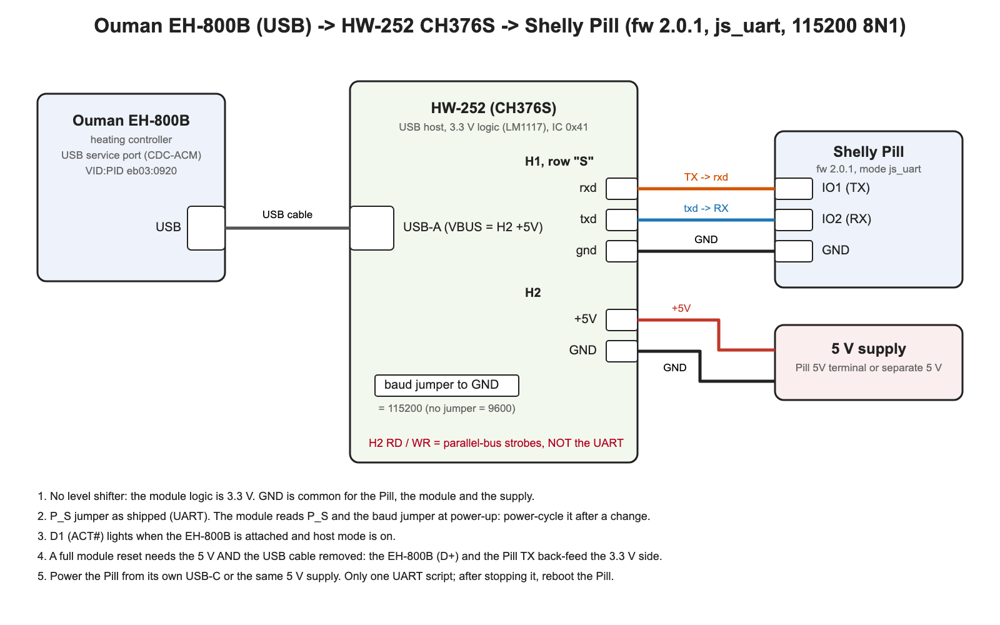

# Ouman EH-800B heating controller with a Shelly Pill (USB, CH376S)

Read and control an **Ouman EH-800B** through its **USB service port** with a **Shelly Pill**
and a **CH376S USB-host module (HW-252)**. The Pill cannot be a USB host itself; the CH376S
does the USB side and the script speaks to it over the Pill UART. No ESPHome, no PC.

**Status: development** (bench-verified 20.–21.10.2026 on an EH-800B V3.0.0 that is not
connected to a heating system). Pill firmware **2.0.1 or later**.

| File | What it does |
|---|---|
| `ouman_eh800b_usb.shelly.js` | **Main script**: USB link, readings, writes, HTTP, MQTT `state` / `diag` / `set` |
| `ouman_eh800b_companion.shelly.js` | **Companion script**: creates the virtual components, Home Assistant MQTT discovery, crash watchdog |
| `wiring.svg` / `wiring.png` | Wiring diagram |
| `tools/` | `pill_upload.py` (upload a script), `ouman_cmd.py` (send a command), `ws_log.py` (read the Pill debug log) |
| `docs/` | Bench log of the first session (Finnish, background material) |

Both scripts run on the same Pill. The split keeps the main script's memory low: the Pill gives
all scripts together about 25 kB of heap.

## 1. Hardware

| Pill | HW-252 |
|---|---|
| IO1 (TX) | H1, row "S": **rxd** |
| IO2 (RX) | H1, row "S": **txd** |
| GND | H1 **gnd** |
| — | H2 **+5V / GND** from a 5 V supply (feeds the module and the USB-A VBUS) |

* The HW-252 logic is 3.3 V (LM1117 on the board): **no level shifter**.
* **Baud jumper on H2 to GND = 115200** (`CFG.BAUD`, default); without the jumper the module
  runs at 9600 and the script must use `BAUD: 9600` (everything is about 10x slower).
* **H2 RD / WR are parallel-bus strobes, not the UART.** Wiring the Pill to them gives no answer at all.
* P_S jumper as shipped. The module reads P_S and the baud jumper at power-up: power-cycle it after a change.
* **A full module reset needs both the 5 V and the USB cable removed**: the EH-800B feeds the
  module back through VBUS.
* D1 (ACT#) lights when the EH-800B is attached and host mode is on.

## 2. Prepare the Pill

1. Firmware 2.0.1 or later.
2. Peripheral mode `js_uart`: `http://<pill-ip>/rpc/Pill.SetConfig?config={"mode":"js_uart"}`.
3. The main script sets the serial port to `CFG.BAUD` 8N1 itself.
4. **Only one script may use the UART.** On firmware 2.0.1 UART receive works only for the
   first UART script started after boot: after stopping or replacing the main script, **reboot the Pill**.

## 3. Install

1. Web UI → Scripts → Add script, name it **`ouman_eh800b_usb`** (the watchdog looks for this
   name), paste `ouman_eh800b_usb.shelly.js`, save. Repeat with `ouman_eh800b_companion` and the
   companion file.
2. Enable **Run on startup** for both.
3. Reboot the Pill. After ~10 s the main script prints `[ouman] link up`; the companion creates
   the virtual components (`[ouman-vc] virtual components ready (9 + group)`).

Or with the tool: `tools/pill_upload.py <pill-ip> ouman_eh800b_usb ouman_eh800b_usb.shelly.js`.

The CFG block at the top of each script is the only part to edit. Main script:

| Key | Default | Meaning |
|---|---|---|
| `BAUD` | 115200 | CH376S UART, must match the H2 baud jumper |
| `POLL_MS` | 15000 | one read round |
| `FULL_EVERY` | 4 | all 28 MEASUREMENTS rows (→ `/diag`) every N rounds |
| `TREND_MIN` | 30 | return water / DHW tank read interval (0 = only on request) |
| `MQTT_PREFIX` | `ouman` | topics `<prefix>/state`, `/diag`, `/set`, `/prop/<id>`, `/debug` |
| `ALLOW_WRITE` | true | false = read-only |
| `WRITE_OK` | see script | property ids that `{"prop":id,"raw":n}` may write |
| `PROPS` | see script | properties read in turn and kept in `/diag` |
| `PROP_SCAN` | true | also read every property id 1–257 and 327–422 in turn → `<prefix>/prop/<id>` |

## 4. What you get

### Virtual components (Shelly app), group "Ouman"

| Id | Role | Source on the EH-800B | Update |
|---|---|---|---|
| number:200 | `outdoor` | `MEASUREMENTS 9` (row 10) | every round |
| number:201 | `supply` | `MEASUREMENTS 8` (row 9, L1 supply water) | every round |
| number:202 | `room` | `MEASUREMENTS 11` (row 12); −999.9 (no sensor) → not updated, `null` in MQTT | every round |
| number:203 | `return` | trend.log field of the measurement channel whose type is **283** (properties 6/7/8 = channel 3/4/5) | every `TREND_MIN` |
| number:204 | `dhw` | same, channel type **237** (DHW tank) | every `TREND_MIN` |
| number:205 | `valve` | `MEASUREMENTS 15` (row 16, L1 valve %) | every round |
| number:206 | `room_set` | property 81 `L1_HUONEASETUSARVO` ÷ 10; slider writes it | every round |
| enum:207 | `mode` | property 59 `L1_SAATIMEN_OHJAUSTILA`; dropdown writes it | every round |
| boolean:208 | `link` | USB link state | on change |
| group:209 | `heating` | | |

That is 10 components, the Pill's maximum. The status (`mode / home-away`) goes to `/diag`.

Mode values (property 59): `auto` 0, `forced_reduced` 1, `forced_big_reduced` 2,
`forced_normal` 3, `shutdown` 5, `manual` 6 (valve to the manual position, property 92).

### Return water and DHW tank: why they are slower

The USB shell has no command for the measurement objects 227–244 and 258–326 (return water 283,
DHW tank 237, boiler 238 …): `GET PROPERTY` covers only the settings, and `MEASUREMENTS` has
28 fixed rows without them. The only USB source is `trend.log` (1440 records of 20 bytes, one
per trend interval, property 26). The script

1. reads the 22-byte header with `TYPE trend.log` (TYPE gives the first 200 bytes of a file):
   `u16` next write index, `u16` 1440, `u16` 20, 8 x `u16` field object ids;
2. starts `UPLOAD trend.log` (XModem-CRC) and **cancels it right after the packet that holds the
   newest record**, so on average half of the 226 packets are transferred;
3. maps trend fields 2/3/4 (measurement channels 3/4/5) by the channel types in properties 6/7/8.

Measured on the bench: ~110–115 packets in **~110–120 s** (0.97–1.04 s per packet).
`state.trend_age_s` tells how old the record is. Notes:

* **The controller pauses its own trend logging during an upload** and does not fill the gap
  later. A shorter upload means a smaller gap in the display trend.
* During an upload the main script keeps the Pill busy: Pill RPC/HTTP answers took a median of
  0.9–2 s (max ~6 s) instead of < 0.2 s.
* With the default trend interval of 600 s the newest record is up to 10 minutes old; a
  shorter interval (e.g. 60 s, property 26) gives fresher values.

### Writing

Writes go out as `SET PROPERTY <id> <raw>` ahead of the reads; the controller answers with the
new value, which is shown at once.

| JSON on `<prefix>/set` or HTTP POST | Sent |
|---|---|
| `{"room_set":21.5}` (5–30, 0.5 steps) | `SET PROPERTY 81 215` |
| `{"mode":"forced_normal"}` | `SET PROPERTY 59 3` |
| `{"away":true}` / `false` | `SET PROPERTY 135 1` / `0` |
| `{"prop":134,"raw":5}` | `SET PROPERTY 134 5`, only for ids in `WRITE_OK` |
| `{"cmd":"TIME"}` | read commands: `MEASUREMENTS`, `MEASUREMENTS <0-27>`, `GET PROPERTY <id>`, `DEVINFO`, `OSINFO`, `TIME`, `LIST`, `GET TIME` |
| `{"trend":true}` | read the trend now |
| `{"debug":true}` / `false` | TX/RX hex on `<prefix>/debug` |

**Never written, whatever `WRITE_OK` says:** PID settings 56–58 and 143–145, manual valve
positions 92 and 179. **Never sent:** `FORMAT`, `DELETE`, `DOWNLOAD`, `UPLOAD` (except the
script's own trend read), `RENAME`, `FIRMWARE`, `PTESTER`, `KEYECHO`, `SET IP/NETMASK/GATEWAY/PORT`.
A rejected request sends nothing to the USB; the reason is in `diag.rej`.

The controller display does not refresh an open menu after a USB write: press ESC and open the menu again.

## 5. HTTP

| Request | Reply |
|---|---|
| `GET http://<pill-ip>/script/<id>/ouman` | `{"accepted":null,"queue":n,"state":{…},"diag":{…}}` |
| `POST http://<pill-ip>/script/<id>/ouman` with a JSON body as above | `{"accepted":true|false,"queue":n}` |

`tools/ouman_cmd.py <pill-ip> <id> 'TIME'` or `'{"room_set":21.5}'` does the same from a shell.

## 6. MQTT reference

Turn on MQTT in the Pill (Settings → MQTT). The script publishes only while the Pill is connected.

`<prefix>/state` (retained, after every round):
`link, ts, outdoor, supply, room, return, dhw, valve, room_set, mode, away, trend_age_s, trend_busy, debug`.

`<prefix>/diag` (after every full read, command and rejection):

| Key | Content |
|---|---|
| `dev` | `DEVINFO` first line |
| `rows` | all 28 MEASUREMENTS rows by name: `supply_curve` (1), `room_comp` (2), `room_comp_time` (3), `supply_target` (7), `supply` (9), `outdoor` (10), `outdoor_slow` (11), `room` (12), `room_slow` (13), `valve_target` (15), `valve` (16), `l2_curve` (19), `supply_setpoint` (20), `outdoor_delay` (21), `l2_target` (27), `digital` (28); others `m<n>` |
| `props` | properties of `PROPS` plus 59 and 81, raw values |
| `status` | `"<mode> / <home|away|off>"` |
| `ch` | channel types of measurement 3/4/5 (properties 6/7/8) |
| `trend` | `epoch` (controller local time), `ptr`, `k`, `pk`/`need` packets, `s` seconds, `raw` (8 fields x 0.1, −9999 = no sensor), `hex` (newest record), `err` |
| `cmd`, `out` | last command and its reply (120 chars) |
| `rej`, `rej_ts` | last rejected request |
| `err`, `n` | last error, number of full reads |

`<prefix>/prop/<id>` (retained): `{"name":"L1_HUONEASETUSARVO","value":210}` for every property
read. The values of 5, 13–16, 18 (SMS numbers, PIN, device id, lock code) and 401–402 (web user
and password) are published as `***`.

## 7. Home Assistant

The companion publishes MQTT discovery (retained, again on every HA restart) for one device
"Ouman EH-800B": sensors for the roles and the named diag rows, `select` mode, `number` room
setpoint / supply fine adjustment (134) / constant supply setpoint (127), `switch` away (135),
`binary_sensor` USB link and a `climate` entity (current = room, or supply when there is no
room sensor; target = room setpoint; presets = modes; action heating when the valve is open).
Entities are available when the Pill is online (`<mqtt topic prefix>/online`) **and** the USB link is up.

## 8. Memory and the watchdog

Measured on firmware 2.0.1 (heap shared by all scripts, ~25.2 kB):

| | Main script `mem_peak` |
|---|---|
| after loading | ~12.5 kB |
| normal operation incl. trend reads (MQTT, 66 min, 3 trend reads) | ≤ 15.8 kB |
| an HTTP GET (state + diag, ~1 kB reply) | 16.1–16.3 kB, up to 17.3 kB during a trend read |

The companion uses ~4.2 kB. If the main script stops on an error (for example
`out_of_memory`), the companion reboots the Pill within a minute, because on firmware 2.0.1 a
UART script only receives after a fresh boot. At most 6 reboots per day (KVS `ouman_wd` =
`<day>:<count>:<errors>`). A script stopped by hand is left alone.

## 9. Troubleshooting

| Symptom | Cause / fix |
|---|---|
| `link down: CH376 CHECK_EXIST` | No answer from the module: TX/RX swapped, wired to H2 RD/WR, wrong baud jumper vs `CFG.BAUD` |
| `link down: no USB device` | EH-800B not attached or the module has no 5 V |
| Link up but all replies empty | Another UART script ran first after boot: reboot the Pill |
| `link down: no reply from the controller` (USB works, no banner, every read NAKed) | The controller's USB shell has stopped (seen once after the USB cable was moved to a PC and back). A power cycle with the USB cable attached does **not** help, because VBUS keeps the controller's USB side powered. Unplug the USB cable, switch the controller off for ≥ 10 s, switch it on, wait for the display, plug the USB cable back |
| Link stays down after the USB cable was unplugged and plugged back (`CHECK_EXIST`, D1 off) | The CH376S hangs when the USB device disappears in the middle of a transfer. Reset the module: USB cable out (it back-feeds the module), module 5 V off for a few seconds, 5 V on, USB cable back. The script reconnects within 30 s; the Pill needs no reboot |
| Values stop, module does not answer after a wire came loose | Same module reset as above |
| `return` / `dhw` stay `null` | No measurement channel has type 283 / 237 (properties 6/7/8), or the trend has not been read yet (`trend_busy`, `trend.err`) |
| Pill web UI slow every 30 min for ~2 min | A trend read is running; raise `TREND_MIN` if this matters |

## 10. Notes on the USB protocol (EH-800B V3.0.0)

* USB CDC-ACM, VID:PID `eb03:0920`. The CH376S does the enumeration (`AUTO_CONFIG`); the script
  sends `SET_LINE_CODING` and **`SET_CONTROL_LINE_STATE` DTR+RTS** — without DTR every bulk IN is NAKed.
  Bulk OUT EP1, bulk IN EP2; the script tracks the DATA0/1 toggles and recovers from a resent packet.
* ASCII commands end with `\n`, replies with `\r\n`; a reply comes ~1 s after the command.
* `GET PROPERTY <id>` → `PROPERTY(81):'L1_HUONEASETUSARVO'(0-950) = 210` (uint16, negative = x − 65536);
  `SET PROPERTY <id> <raw>` answers in the same form. Settings 1–257 and 327–422 answer; the
  measurement objects do not (the GET help is printed instead).
* `MEASUREMENTS <n>` (undocumented) returns row n+1 alone, n = 0–27 (the help says 0–16; n is 8-bit).
* The controller does not wait for a slow host: an output larger than ~1 kB that it produces at
  once is cut (`?` gives 947 of ~1 100 bytes through the CH376S), and `TYPE` gives at most 200 bytes.
  On a PC both come out whole (`TYPE error.log` 360 bytes), so the limit is the bridge, not the firmware.
* The full `?` list of V3.0.0 is the same as in V2.2.2 (… `SET CLOCK`, `SET DATE`, `SET DAY`, `FIRMWARE`,
  `PTESTER`); `GET` / `SET PROPERTY` and `MEASUREMENTS <n>` are not listed.
* `UPLOAD <file>` = XModem-CRC (128-byte blocks, 0x1A padding). Cancelling with CAN must be
  followed by a newline, or the CANs prefix the next shell command (`Unknown command`). An upload
  cut off by a reboot later sends EOT into the next reply; the script cancels and flushes at start.
* The numbering is the same as in the EH-800 Ethernet interface (`S_<id>_85`); the Home Assistant
  `ouman_eh_800` integration uses that HTTP interface and does not apply to the EH-800B.

## Changes in 20261021-15

* Every transaction step timer carries a link generation; `fail()` cancels the pending reply and
  timers. A poll left over from a broken transfer could reach the CH376S right after its reset,
  before "no retry on NAK" was set again, and hang the module until a power cycle.
* Six empty replies in a row → `link down: no reply from the controller`, retry every 30 s, so
  Home Assistant shows the entities as unavailable instead of stale values.

## Changes in 20261021-14 (first repository version)

Rewrite of the bench prototype: virtual components and Home Assistant discovery (companion),
MQTT `state` / `diag` / `set`, single-row reads for the virtual components, trend read cut at
the newest record, CAN + flush at start, DATA toggle recovery, byte-wise CRC (upload 1.8 → 1.0 s
per packet), credential masking on `/prop`, memory reductions (peak 19.4 → 15.0 kB).

## License and credits

Apache-2.0, see `LICENSE` and `NOTICE` in the repository root. Property and object numbers were
cross-checked with tjani8/ouman-eh-800-home-assistant (MIT) and the trend.log layout with
mcgurk/Ouman_EH-800_USB-serial; the scripts are an independent implementation and contain no
code from those or other projects.
