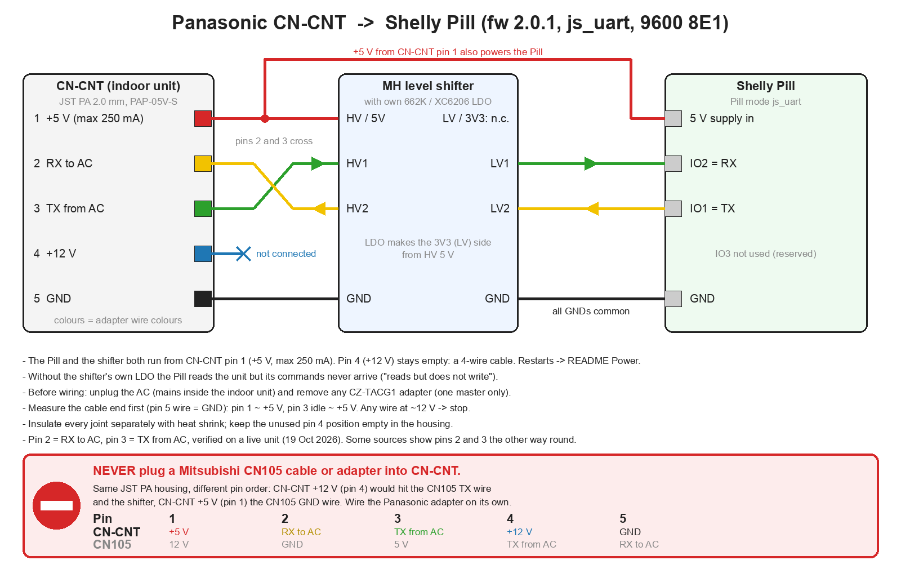

# Panasonic heat pump control with a Shelly Pill (CN-CNT)

> **Status: in development.** Tested on one Panasonic indoor unit (October 2026):
> reading all values, control of every setting, defrost state, 23 hours without a single
> missed poll, and the unit's built-in Wi-Fi module running at the same time. More units
> are welcome. The script starts in **READ_ONLY** mode: it only polls the unit and never
> sends a control frame until you switch that off (section 6).

Read and control a Panasonic air-to-air heat pump from the Shelly app, and optionally
over MQTT or HTTP, with a **Shelly Pill** on the indoor unit's **CN-CNT** port, which is
where the CZ-TACG1 Wi-Fi adapter normally plugs in. One Shelly script handles the
protocol. No ESPHome, no extra microcontroller.

**Requires Pill firmware 2.0.1 or later** (`js_uart` peripheral mode).

The protocol knowledge comes from
[DomiStyle/esphome-panasonic-ac](https://github.com/DomiStyle/esphome-panasonic-ac)
(CZ-TACG1 / CN-CNT part; see [License and credits](#license-and-credits)). **Not for
Aquarea air-to-water units:** they have a CN-CNT port too, with the same connector, but
they speak a different protocol (HeishaMon).

## What is in this folder

| File | Purpose |
|---|---|
| `panasonic_cncnt.shelly.js` | The Shelly script. Paste it into the Pill. Edit only the `CFG` block. |
| `wiring.png` | Wiring diagram: CN-CNT → level shifter → Pill, with the CN105 warning. |

What you get:

* Shelly app: virtual components Power, Mode, Fan, Vane, WVane, Target temperature,
  Room temperature, Link and Power consumption (W), grouped as one virtual device ("PanasonicAC").
* MQTT (optional): `<prefix>/state`, `<prefix>/set`, `<prefix>/diag`, `<prefix>/debug`.
* HTTP: `http://<pill-ip>/script/<id>/pac`.

## 1. Hardware

> ⛔ **Never plug a Mitsubishi CN105 cable or adapter into CN-CNT.** The housing is the
> same (JST PA), but the pin order differs. CN-CNT +12 V (pin 4) would reach the CN105 TX
> wire and the level shifter, and CN-CNT +5 V (pin 1) the CN105 GND wire. Build the
> Panasonic adapter on its own, or rewire a CN105 pigtail to the table below.

> ⚠️ **The level shifter must have its own LDO** (marked 662K or XC6206). The Pill does
> not provide 3.3 V on its terminals. Without the LDO the Pill can *read* the unit,
> but its commands never arrive ("reads but does not write").

### Parts

| Part | Notes |
|---|---|
| Cable housing | **JST PA, 2.0 mm pitch, 5 pins: PAP-05V-S** (e.g. RS 476-6768) |
| Contacts | JST **SPHD-002T-P0.5** (AWG 28–24) or SPHD-001T-P0.5 (AWG 26–22); pre-crimped PA leads work too |
| Wire | 4 × 24 AWG (pins 1, 2, 3, 5), 15–30 cm (the Pill sits where the CZ-TACG1 was); pin 4 stays empty |
| Level shifter | 2-channel MH (BSS138) module **with its own 662K / XC6206 LDO** |
| Heat shrink | for **every** joint separately |

### Pinout and wiring

Pin numbers in HeishaMon order. On the DomiStyle connector photo, with the latch
towards you, left to right is the same order. The table names the signals from the
unit's side.

> **Pins 2 and 3 were verified on a real unit:** pin 2 is the unit's RX and pin 3 the
> unit's TX. Some sources show them the other way round. With pins 2 and 3 swapped, the
> Pill polls but gets no reply at all. The Pill-to-shifter side is the same as in the
> Mitsubishi CN105 adapter; only the connector pins differ.

| CN-CNT pin | Signal | Connect to |
|---|---|---|
| 1 | +5 V (max 250 mA) | shifter **HV / 5V** (the shifter's LDO makes the 3V3 side from it) **and** Pill **5 V supply** |
| 2 | RX to the unit (0–5 V) | Pill **IO1 (TX)** → shifter **LV2 → HV2** |
| 3 | TX from the unit (0–5 V) | shifter **HV1 → LV1** → Pill **IO2 (RX)** |
| 4 | +12 V | **not connected** (leave the position in the housing empty). Never to a signal. |
| 5 | GND | shifter GND (both sides) + Pill GND |

### Power

The Pill and the shifter both run from pin 1, as an ESP32 does with DomiStyle and HeishaMon.
CN-CNT gives at most 250 mA there (HeishaMon). On the test unit the Pill ran 23 hours
without a restart this way. Signs of overload: the Pill restarts now and then (`uptime_s` in
`<prefix>/diag` drops back to a small value), or polls go unanswered while Wi-Fi is busy.
If that happens, in this order:

1. Add an electrolytic capacitor (100–470 µF) across the Pill's 5 V supply, close to the Pill.
2. Power the Pill from pin 4 (+12 V) through a 12 → 5 V buck converter and keep pin 1 only as
   the shifter's reference.

Leave the shifter's LV / 3V3 pin unconnected when the module has its own LDO. Pill IO3
is not used (`js_uart` reserves it).



### Before you connect anything

1. **Remove the CZ-TACG1 adapter** if one is installed: CN-CNT can have only one master.
   A built-in Wi-Fi module or a DNSK-P11 on the separate CN-WLAN port may stay: on the
   test unit the built-in Wi-Fi ran next to the Pill without a single missed poll.
2. **Measure the loose cable end**, with the cable plugged into CN-CNT, the unit powered,
   and the shifter and Pill not connected. Use the pin 5 wire (GND) as reference: pin 1 ≈ +5 V,
   pin 3 idle ≈ +5 V (the unit's TX; UART idle is high), pin 2 pulled up or floating.
   **No wire of the cable may show ≈ 12 V. If one does, the cable is the wrong way round.
   Do not connect it.**
3. Do the wiring with the **unit unplugged from mains**. The indoor unit has mains voltage
   inside.

## 2. Prepare the Pill

1. Update the Pill to firmware **2.0.1 or later**.
2. Select the **Serial Communication (UART)** peripheral mode:
   Shelly app → the Pill → **Settings** → **Pill Peripheral Settings** → **Serial
   Communication (UART)**, or web UI → **Pill configuration** → **Peripheral setup** →
   **Serial Communication (UART)**. The script log shows this mode as `js_uart`.

You do not need to set the baud rate or parity. The script sets serial port 0 to
`js_uart` 9600 8E1 on every start and corrects it without a reboot, for example after a
firmware update has reset it to 115200 8N1.

## 3. Install the script

1. Web UI → **Scripts** → **Add script**, paste the whole `panasonic_cncnt.shelly.js`,
   **Save**, **Start**, enable **Run on startup**.
2. For the first run set `DEBUG: true` in the `CFG` block (every TX/RX frame goes to the
   log, and to `<prefix>/debug` when MQTT is on). Keep `READ_ONLY: true`.
3. Watch the script log. A start looks like this (reply bytes depend on your unit):

   ```
   [pac] Fixing Serial config -> js_uart 9600 8E1
   [pac] UART 9600 8E1, READ_ONLY=true
   [pac] Debug on, auto-off in 1440 min
   [pac] TX 70 0A 00 00 00 00 00 00 00 00 00 00 86
   [pac] RX 70 20 34 2B 80 50 19 40 00 40 00 00 3E 2D ... 8C
   [pac] Link up
   [pac] {"connected":true,"power":"ON","mode":"COOL","temp":21.5,"fan":"3",...,"room_temp":22,...}
   [pac] fw=2.0.1 app=Pill
   [pac] Pill mode="js_uart"
   [pac] Virtual components ready (virtual_add)
   ```

   With `MQTT_HOST` set, the first start on a Pill whose MQTT is still off also shows
   `MQTT is off on the Pill - <prefix>/set not subscribed yet` (normal),
   `Applying MQTT broker …` and `MQTT config applied - rebooting once to activate it`. After
   the reboot: `MQTT broker … (TLS) as configured`.

   The poll `70 0A 00 00 00 00 00 00 00 00 00 00 86` goes out every 5 s and must be
   exactly 13 bytes. A state line is printed when something changes.

The script creates its 10 virtual components itself (`Virtual.Add`, ids 200–209): the 8
controls and readings, the group and, last, **Power consumption** (W, read-only). A Shelly
device holds at most **10** virtual components in total, so components of other scripts can
leave some of these out (`VC … failed: Reached the maximum 10 of virtual components`); Power
consumption is created last and is the first to be left out. The script then works without
them. The script does not use the newer `@meta` declaration: on Pill firmware 2.0.1 a script
with an `@meta` virtual-component block crashed the device when it was started.

On every start the script refreshes the components it already created (names, option lists,
how they are shown). Option titles, images and icons that you set in the Shelly app or cloud
are kept, and a component you hide in the app stays hidden; the script only fills in a view
that was never set.

## 4. Configuration (`CFG`)

| Key | Default | Meaning |
|---|---|---|
| `READ_ONLY` | `true` | `true` = never send a control frame; every command is logged and ignored |
| `DEBUG` | `false` | log every TX/RX frame (and publish it to `<prefix>/debug`) |
| `DEBUG_FLUSH_MS` | `2000` | `<prefix>/debug` is sent in batches, one message per this period |
| `DEBUG_AUTO_OFF_MIN` | `1440` | `DEBUG` switches itself off after this many minutes (`0` = never) |
| `MQTT_ENABLE` | `false` | master switch for MQTT (`false` = no MQTT at all) |
| `MQTT_HOST` | `""` | `""` = use the broker set in the Pill's web UI (**Settings → MQTT**; set its prefix to `MQTT_PREFIX`). `"host"` or `"host:port"` = the script writes the broker into the Pill's MQTT settings at start and reboots **once** (`MQTT config applied`) |
| `MQTT_TLS` | `false` | `true` = TLS, the server is checked with the Pill's built-in CA bundle (`ca.pem`); default port 8883 |
| `MQTT_USER` / `MQTT_PASS` | `""` | broker user and password (only with `MQTT_HOST`). The password goes only to the Pill's MQTT settings and is never printed or published |
| `MQTT_RPC` | `true` | `false` = no RPC, notifications or Shelly MQTT control over MQTT (for a shared broker) |
| `MQTT_PREFIX` | `"panasonic"` | topic prefix (with `MQTT_HOST` also the Pill's own prefix, so its `<prefix>/online` is the availability topic) |
| `HTTP_ENDPOINT` | `"pac"` | `http://<pill-ip>/script/<id>/pac` |
| `POLL_MS` | `5000` | poll interval, counted from the last frame sent |
| `CMD_GAP_MS` | `250` | minimum gap before a control frame |
| `VERIFY_POLL_MS` | `500` | extra poll after a control frame, to verify it |
| `SET_MAX_AGE_MS` | `1000` | a control frame is built only from a poll this fresh; otherwise the script polls first |
| `LINK_FAILS` | `3` | polls in a row without a valid reply → Link off |
| `MIN_TEMP` / `MAX_TEMP` | `16` / `30` | target temperature range (step 0.5 °C) |

### MQTT broker from the script

With `MQTT_HOST` set, the script writes the broker into the Pill's own MQTT settings on the
first start and reboots once. A copy of the script that carries a password should stay on
that one Pill; do not publish it. Once the Pill's MQTT is set up, you can switch back to
`MQTT_HOST: ""` and empty `MQTT_USER` / `MQTT_PASS`: the Pill keeps its settings, and the
script no longer needs the password.

Firmware 2.0.1 writes the parameters of every script RPC call to its debug log, the
password of the one-time `Mqtt.SetConfig` included. Keep the web debug log, UDP and MQTT
debug logging off while the script applies the broker on the first start.

## 5. Commands, MQTT and HTTP

Commands are JSON, the same on MQTT `<prefix>/set`, HTTP POST and (for the basic keys)
the Shelly app:

| Key | Values | Bytes changed (data[i] = reply byte i+2) |
|---|---|---|
| `power` | `"ON"`, `"OFF"` | data[0] low nibble (`4` / `0`) |
| `mode` | `"HEAT"`, `"DRY"`, `"COOL"`, `"FAN"`, `"AUTO"` | data[0] = `44/24/34/64/04`. **Setting a mode also switches the unit on.** |
| `temp` | 16–30, step 0.5 | data[1] = temp × 2 |
| `fan` | `"AUTO"`, `"QUIET"`, `"POWERFUL"`, `"1"` … `"5"` | data[3] = `A0/30/40/50/60/70`; a speed also clears powerful/quiet. `QUIET`/`POWERFUL` = fan AUTO (`A0`) + preset, as the remote shows them; the Fan component and `state.fan` show them the same way |
| `vane` (vertical) | `"AUTO"`, `"1"` (up) … `"5"` (down), `"SWING"` | data[4] high nibble |
| `wideVane` (horizontal) | `"<<"`, `"<"`, `"\|"`, `">"`, `">>"`, `"AUTO"` | data[4] low nibble (units without left/right louvres report none: WVane stays empty) |
| `swing` | `"BOTH"`, `"OFF"`, `"VERTICAL"`, `"HORIZONTAL"` | data[4] = `FD/36/F6/3D` |
| `preset` | `"NORMAL"`, `"POWERFUL"`, `"QUIET"` | data[5] low nibble |
| `eco` | `true` / `false` | data[8] = `40` / `00` |
| `nanoex` | `true` / `false` | data[5] bit `0x40` only |
| `econavi` | `true` / `false` | data[5] bit `0x10` only |
| `mild_dry` | `true` / `false` | data[2] = `7F` / `80` |
| `echo` | `true` | re-send the current state unchanged (safest first write test) |

Script switches, accepted also while `READ_ONLY` is on and without a link, valid until
the script restarts:

| Key | Values | Effect |
|---|---|---|
| `debug` | `true` / `false` | frame dump on/off; `true` restarts the auto-off timer |
| `read_only` | `true` / `false` | block / allow control frames (section 6) |

Several keys in one command, or several commands within `CMD_GAP_MS`, go out as **one**
control frame: the latest poll's 10 state bytes with the changes applied, then a
checksum. The unit sends no acknowledgement and does not beep. The script polls again
`VERIFY_POLL_MS` later and reports `set_verified` in `<prefix>/diag`.

| Topic | Content |
|---|---|
| `<prefix>/state` | common core, the same keys on every brand: `connected` (= Link), `power`, `mode`, `temp`, `fan`, `vane`, `wideVane`, `room_temp`, `operating` (always `null`: not in this protocol), `defrost`, `remote_temp` (`0`), `remote_temp_source` (`"internal"`), `remote_temp_age_s` (`null`), `debug` |
| `<prefix>/diag` | all Panasonic data: `outside_temp`, `power_w`, `defrost`, `eco`, `nanoex`, `econavi`, `mild_dry`, `preset`, `room_src`/`outside_src` (reply byte used), `uptime_s` (Pill uptime, restarts show as a drop), `unknown` (data bytes 6, 7, 9 as hex), `raw` (the whole last reply as hex), `set_verified`, `set_diff`, `set_last`, `counters` |
| `<prefix>/debug` | with `DEBUG: true`: plain text, one message per `DEBUG_FLUSH_MS`, one line per event: `T <hex> @<ms>` = frame sent, `R <hex> @<ms>` = valid frame received, `X <hex> @<ms>` = raw UART chunk; `<ms>` = milliseconds since the script started. `X` lines are written only while there is no link (wiring and parity checks); with a link the `R` lines carry the same bytes. At most 1 kB waits for sending; if MQTT is down longer, the oldest lines are dropped and the next message starts with `...dropped N` |

HTTP: `GET /script/<id>/pac` → state JSON, `GET /script/<id>/pac?diag` → diag JSON,
`POST` with a command JSON body → command, then the state JSON.

## 6. First start: read first, then control

**1. Read only** (`READ_ONLY: true`, `DEBUG: true`):

1. The poll is exactly `70 0A 00 00 00 00 00 00 00 00 00 00 86` every 5 s, and replies start
   with `70`. `Link up` appears, and `counters.bad` in diag stays at 0.
2. Change mode, target temperature, fan and vanes **with the IR remote**, one at a time.
   Each change must show in the next state line (≤ 5 s) with the right value.
3. Check that room and outside temperature look right and that `power_w` follows the
   compressor.
4. Leave it running for some hours. In READ_ONLY mode no frame starting with `F0` may
   appear in the TX log, and `uptime_s` in diag must keep growing (no Pill restarts).

**2. Control:** switch writing on, either for good with `READ_ONLY: false` in the `CFG`
block (then restart the script), or until the next restart with the command
`{"read_only":false}` (MQTT `<prefix>/set`, or
`curl -s -X POST http://<pill-ip>/script/<N>/pac -d '{"read_only":false}'`, N = the script id).
`{"read_only":true}` switches it back at once.

1. First send `{"echo":true}`. The control frame re-sends the current state, so nothing
   should change on the unit.
2. Then change one thing at a time from the app or with a command, for example
   `{"temp": <current + 0.5>}`, `{"fan":"AUTO"}`, `{"power":"OFF"}` → `{"power":"ON"}`.
3. After each one, `diag.set_verified` must be `true` and the unit must follow.

On the test unit every control frame was accepted on the first try, and a change made
with the IR remote between two control frames was kept (the script builds every control
frame from a fresh poll).

## 7. Troubleshooting

| Symptom | Check |
|---|---|
| No reply at all, `Link` stays off (`rx 0`, `bad 0`, `drop 0`, no `X` lines) | TX and RX swapped (pin 2 must go to the Pill's IO1/TX, pin 3 to IO2/RX: see Pinout); the shifter has no 5 V reference (pin 1); the serial port not 9600 8E1 (see the `UART` log line); a CZ-TACG1 still plugged into CN-CNT |
| State is read, but commands do nothing (`set_verified: false`) | "reads but does not write": the shifter has no LDO, or the LV2/HV2 channel or the pin 2 wire is broken. Check this before you suspect the protocol. |
| `WARNING: received our own poll back` | TX and RX wires are joined somewhere |
| `READ_ONLY: command ignored` | expected while `READ_ONLY: true` |
| A change made with the Pill is undone when someone uses the IR remote | expected: the remote sends its whole state (temperature, mode, fan …) as shown on its own display, which does not know about changes made through the Pill. The Pill builds its commands from a fresh poll, so it never undoes remote changes. |
| `No link to the unit: command ignored` | commands are accepted only while Link is on |
| Comments in the script look garbled after loading it in the Shelly Cloud editor | the cloud editor splits multi-byte characters at its transfer chunk borders; this script's comments are plain ASCII, so use this version as it is |
| `ERROR: frame truncated` | the firmware cannot build zero bytes; please open an issue with the firmware version |
| `Too many calls in progress` | the script makes at most one RPC at a time. If you add your own `Shelly.call()`s, start them after `Virtual components ready`. |
| `VC … failed: Reached the maximum 10 of virtual components` | other scripts' virtual components fill the device's limit of 10; the missing ones are simply not shown in the app |
| The device restarts when a script is started | a script with an `@meta` block (not this one) on firmware 2.0.1; this script has none |

## 8. Protocol notes

9600 8E1, 5 V TTL, the Pill is the master and the unit only answers. Every frame is
`header, length, data…, checksum`, and all bytes sum to 0 mod 256. Header `0x70` is the
poll (10 zero data bytes) and the state reply (35 bytes on the test unit); `0xF0` is a
control frame carrying the 10 state bytes. There is no handshake; the first valid reply
sets Link on. `0x70` also occurs inside data (fan 5 = `0x70`), so the receiver resyncs on
header + length + checksum, never on the header alone. Reply byte 14 = `0x02` during a
defrost (on the test unit about 7–11 minutes every hour or so at 0 °C outside); power is
`rx[28] + 256 × rx[29] − rx[30]` W.

Differences from DomiStyle (on purpose): `nanoex` and `econavi` change only their own
bit (DomiStyle rewrites the whole nibble or byte and clears the other flags); a verify
poll 500 ms after each control frame; a fresh poll before a control frame when the last
one is older than 1 s, so a change made with the remote is not reverted; Link off after
3 missed polls.

## License and credits

Copyright 2026 Teemu Virta. Licensed under the Apache License, Version 2.0 (see `LICENSE`
in the repository root).

Protocol knowledge (frame layout, byte positions, codes and the checksum) is based on
[DomiStyle/esphome-panasonic-ac](https://github.com/DomiStyle/esphome-panasonic-ac)
(MIT, commit `c56eb4f`, CZ-TACG1 / CN-CNT part). This script is an independent
implementation for the Shelly scripting engine (Espruino) and does not contain code from
that project. Connector part numbers and the pin order come from the documentation of
[Egyras/HeishaMon](https://github.com/Egyras/HeishaMon).
